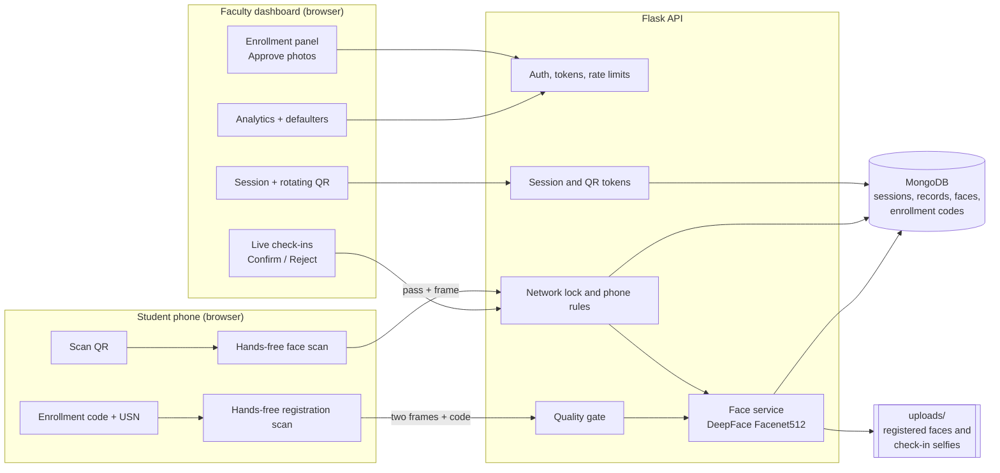
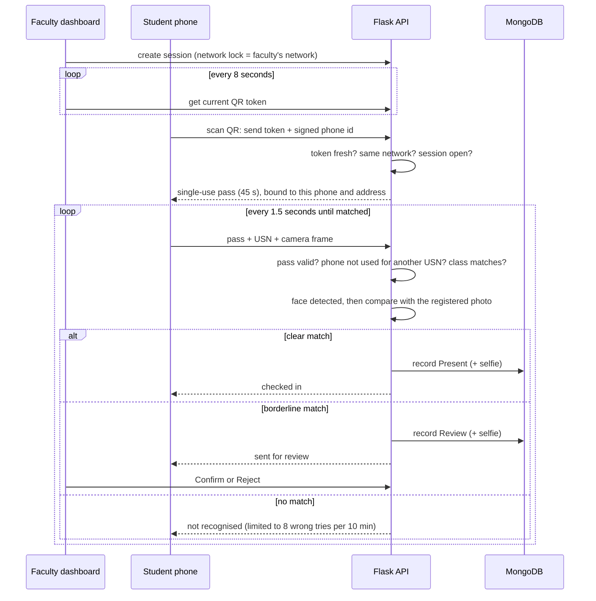

# FaceTrack QR

Track Faces. Verify Presence. Simplify Attendance.

## Overview

FaceTrack QR is a classroom attendance system built to stop **proxy attendance** (a friend marking you present)
without making attendance slow for honest students.

A faculty member opens a short session and shows a QR code that changes every few seconds. A student scans
it with their own phone, looks at the camera for a second, and is checked in. There is no photo button: the
page captures the face by itself. The server verifies the face, the phone, the network and the timing, and
anything doubtful is shown to the faculty instead of being counted silently.

> **Status:** works end to end on a local network (tested on real phones). It is not deployed to the cloud
> yet, and some protections are written for a classroom Wi-Fi. See [Known limitations](#known-limitations).

## How it stops proxy attendance

| Layer | What it does |
|---|---|
| Rotating QR | The QR token changes every 8 s, so a screenshot or forwarded link goes stale almost at once. |
| Single-use check-in pass | Scanning trades the token for a pass (valid 45 s) that is bound to that phone and network address and can be used once. |
| Network lock | A session accepts check-ins only from the network the faculty started it on. Attempts from elsewhere are counted and shown. |
| Face match on the server | Facenet512 compares a live frame with the registered photo. The browser never decides. |
| One student per phone | Each phone gets a server-signed id; a phone (and, on a private Wi-Fi, an address) can check in only one student per session. |
| Trusted registration | Faces are enrolled in class with a 5-minute faculty code, hands-free, with quality checks, and stay *pending* until the faculty approves the photo. |
| Borderline hold | A match that only just passes (where look-alikes and siblings land) is held for the faculty to confirm. |
| Evidence | Each check-in stores its selfie so the faculty can check anyone, with a live list, flags and a Reject button. |

## Architecture



### Check-in flow



### Registration flow

1. The faculty opens an enrollment window: a 6-character code and QR, valid 5 minutes, locked to the
   faculty's network.
2. The student scans it, enters their USN and taps **Start face scan**.
3. The page captures two frames about a second apart. The server checks each (one clear face, big enough,
   centred, straight, well lit, sharp) and that both show the same person, then keeps the sharper one.
   Unclear frames get a hint such as "Move closer" or "Too dark" and the scan continues.
4. The face is stored as **pending**. The faculty sees the photo in the Enrollment panel and approves or
   rejects it. Only approved faces can check in.

## Threat model

What a dishonest student might try, what stops it, and what still gets through.

| Attack | Defence | What is left |
|---|---|---|
| Share or screenshot the QR | 8 s rotation; pass is single-use, 45 s, bound to phone and address | A friend physically on the same network can relay the live QR within seconds. The faculty list and selfies catch it. |
| Check in from another room on the same network | Network lock to the faculty's network | A college Wi-Fi covers many rooms, so the network cannot tell rooms apart. Selfies and the live list are the check. |
| Mark a friend present with the friend's USN | Server-side face match; one student per phone; pass tied to the phone | None for a different face. A lookalike is the next row. |
| Sibling or lookalike | Facenet512; matches in the grey zone are held for the faculty | A sibling can still reach the faculty review. See [docs/ACCURACY.md](docs/ACCURACY.md). |
| Register a classmate's USN with your own face | Enrollment code, 5 min, faculty network, one student per phone and address, faculty approves the photo | The faculty must actually look at the photo. |
| Reset the phone id to dodge the one-per-phone rule | Phone ids are signed by the server; on a private Wi-Fi the address is checked too | On a shared public address the address rule is skipped (cloud caveat). |
| Photo or video of the real student held to the camera | Optional anti-spoof model (off by default, not reliable enough) | **Not defended.** There is no liveness check. |
| Brute-force faces against someone's USN | 8 wrong faces per address and USN per 10 minutes | Per-address limits would need rework behind one public address. |
| Forge `X-Forwarded-For` to fake the network | Proxy headers are trusted only when configured, and the backend is bound to localhost behind the proxy | Do not expose the backend directly with proxy trust on. |
| Probe the face matcher or other students' data | Face test endpoint is faculty-only; faculty routes are scoped to their own classes | Student attendance lookup by USN is still public. |
| Steal or guess faculty credentials | PBKDF2 hashing, signed expiring tokens, login rate limits | Standard web risks apply; set `SECRET_KEY` in production. |

## Features

### Faculty
* Login, session creation, rotating QR, countdown timer
* Live check-in list (text only; photo on click), blocked-attempt warnings, Confirm / Reject
* Enrollment window with approval queue for registered faces
* Analytics, attendance trends, defaulter list, session history, CSV export

### Student
* Hands-free face registration (once, in class)
* QR + hands-free face check-in
* Attendance percentage and face status lookup

## Technology stack

* **Frontend:** React 19, Vite, React Router, Axios, Recharts, react-webcam, html5-qrcode, qrcode.react, plain CSS
* **Backend:** Flask, flask-cors, DeepFace (Facenet512 via ONNX, OpenCV detector), OpenCV, itsdangerous (signed tokens), Werkzeug (PBKDF2)
* **Database:** MongoDB (local or Atlas) via pymongo
* **Phones:** the live camera needs https, so a self-signed dev certificate and proxy are provided

## Run it locally

Step-by-step instructions, including testing on a phone over https, are in [Steps.txt](Steps.txt). In short:

```bash
# backend
cd backend
pip install -r requirements.txt
cp .env.example .env            # then edit; see the comments inside
python app.py

# frontend
cd frontend
npm install
npm run dev
```

`python seed_data.py` creates a demo faculty (`FAC001` / `password123`) for local testing only; never use it
in a real deployment.

All settings (pass mark, QR timing, network lock, registration limits, borderline hold) are documented in
`backend/.env.example`.

## Testing

The backend has 300+ automated checks in `backend/tests/` (security, network lock, check-in rules, proxy
protections, registration quality, borderline hold, accuracy tool):

```bash
cd backend
pip install -r requirements.txt
python tests/run_tests.py            # all suites; or: python tests/run_tests.py proxy scan
```

The runner is safe by design: it copies the backend to a temp folder, starts a throwaway MongoDB (needs
`mongod` on your PATH, or set `FT_TEST_MONGO_URI`), and swaps DeepFace for a small stand-in, so it never
touches your real database or photos and needs no model download. The runner refuses to run on MongoDB's
default port.

## Accuracy

How well the face check separates the right person from a look-alike is measured with
`backend/tools/accuracy_report.py`. The latest results, method and honest limits are in
[docs/ACCURACY.md](docs/ACCURACY.md). The sample is small (two people), so the numbers show behaviour, not a
precise accuracy percentage.

## Known limitations

* No liveness detection: a photo or video of a student's face may fool the matcher.
* Siblings and lookalikes can reach the borderline zone and rely on the faculty to confirm.
* One network cannot tell classrooms apart; the network lock stops students outside the building, not in
  another room.
* Not deployed: the per-address limits and the public student lookup need work before a cloud deployment
  behind a shared public address.
* The accuracy sample is small.

## Future enhancements

* Liveness check (blink / head-turn challenge)
* Cloud deployment with NAT-safe rate limits
* PIN or OTP for student lookups
* Larger accuracy study with classmates' data
* Mobile application and attendance alerts

## Author

Gagandeep Y
Bachelor of Engineering
FaceTrack QR Project
